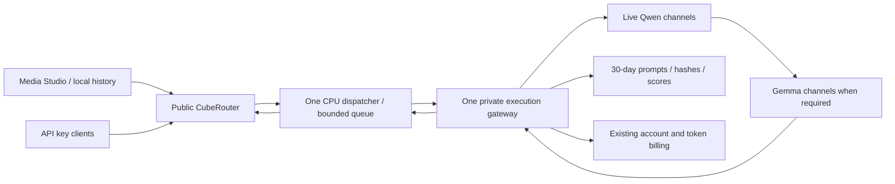

# Qwen Image 2.1 in CubeRouter Media Studio

Latest HKBN functionality adapted to CubeRouter React 19 / TypeScript: ten
references, official examples loaded as drafts, freehand colored strokes without
automatic closure, continued editing with retained dimensions, browser history,
shared generation/API queue, dynamic GPU channels, Gemma review and audit UI.

Start with [DEPLOYMENT.md](DEPLOYMENT.md); API integration and independent
per-group moderation policy are in [API-QUEUE.md](API-QUEUE.md).
Edit seed handling and the optional worker quality patch are documented in
[EDIT_QUALITY.md](EDIT_QUALITY.md).



API review defaults to external (integrator-managed), with root-admin opt-in to
required Gemma review per account group. Browser review follows moderation
channels. No channel count/node IP is hardcoded.

## Verification

```sh
python -m unittest discover -s deploy/image-studio -p 'test_*.py'
python -m pytest deploy/image-moderation -q
go test ./controller ./middleware ./model -run 'Test(ImageStudio|Studio|ImageChannel|ImageAPI|ImageModeration)' -count=1
go build -o cuberouter .
python deploy/image-studio/smoke_api.py /absolute/path/to/cuberouter
cd web
bun run typecheck
bun run test src/features/media-studio src/features/image-studio-audit
bun run build
```

Local smoke uses real Go/dispatcher with **simulated** GPU/Gemma; it verifies
contracts, not inference throughput. `TestImageStudioDatabaseMatrix` accepts
disposable `STUDIO_TEST_MYSQL_DSN` / `STUDIO_TEST_POSTGRES_DSN` alongside SQLite
for fresh/upgrade migrations, restart, idempotent admission, policies, leases,
private reviewers and expiry. CI supplies all three engines.

### Sync validation (2026-10-05)

Based on `suanova/cuberouter` main `3a460f57`, incorporating the HKBN image
implementation through `68adec43` (including the queued API/audit work).
The destination keeps its React 19 UI, organization billing, BASE_PATH support
and existing reference-upload behavior. Image moderation uses channel type 65;
CubeStack retains type 64. Do not import channel type numbers from Nutsflush.

- All 1,184 frontend tests passed, along with TypeScript and the production build.
- Image-related Go controller, middleware, model, router and billing tests passed;
  affected-package `go vet` passed.
- 55 dispatcher tests and 21 classifier/pool tests passed.
- Fresh/upgrade/repeated migrations passed on SQLite 3.50.4, MySQL 8.0.46 and
  PostgreSQL 16.15, including retention, claims, policies and moderation leases.
- Real local gateway/dispatcher with simulated GPU/reviewer passed generation,
  multipart edits, four-account queueing, billed tokens, idempotency, async
  polling, review approval/block/outage, group denial and ordinary chat API.
- The full Go suite is not green on this Windows host: unrelated SQLite fixture
  cleanup locks and channel-affinity cache assertions fail. Representative
  failures also reproduce on untouched main `3a460f57`. CI still runs the full
  Linux suite; this sync does not suppress those tests.

No destination deployment, production channel configuration or real-GPU capacity
acceptance is performed by these checks. Deploy and validate the matching gateway,
web build and dispatcher in staging as described in [DEPLOYMENT.md](DEPLOYMENT.md).

### Full-context image quality (2026-10-13)

The optional GPU worker patch also includes Nutsflush MR !16: full VAE context
for creation and all one-to-ten-reference edits, higher count-specific reference
budgets, and release of completed conditioning caches before decoding. Original
PNG bytes, output dimensions, model weights and dtype are preserved. An OOM does
not trigger an automatic retry at lower quality. See [EDIT_QUALITY.md](EDIT_QUALITY.md)
for controlled GPU evidence, limits, required health flags and separate rollout.
Merging or deploying the CubeRouter gateway/dispatcher does not update a mounted
GPU worker. This change does not alter the CubeRouter UI or navigation.
